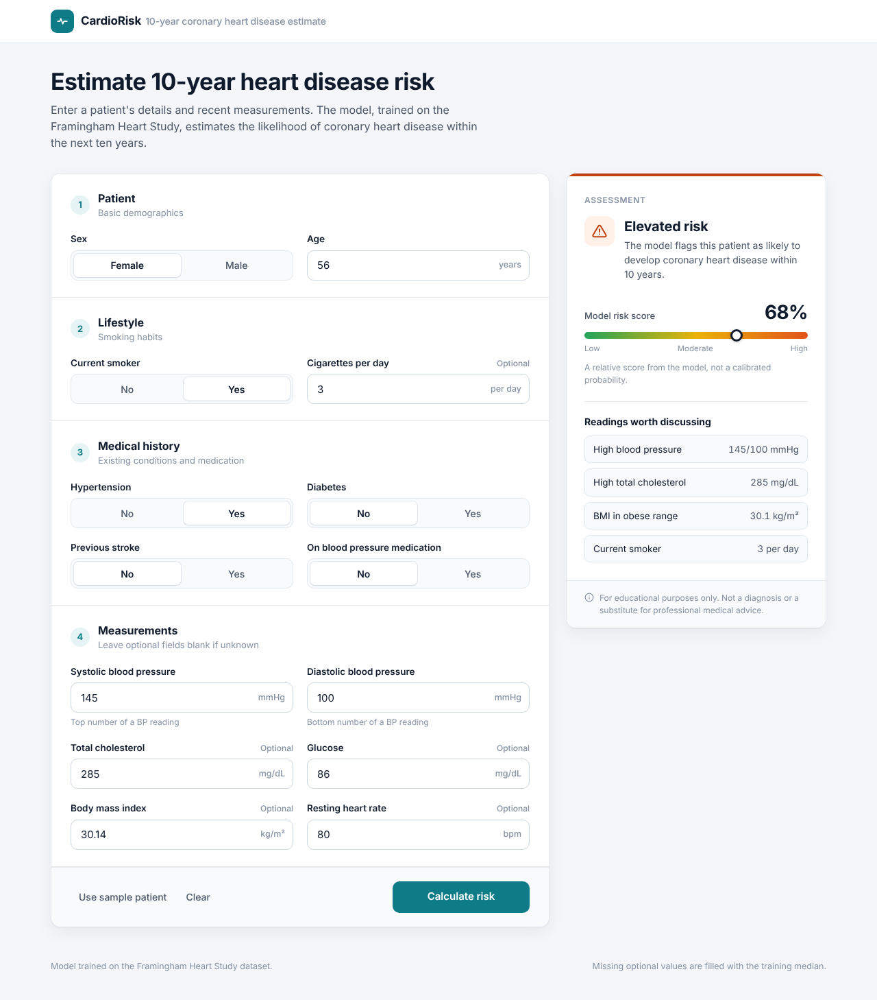

# CardioRisk: 10-Year Heart Disease Risk Prediction


An end-to-end machine learning project that estimates a patient's risk of developing coronary heart disease (CHD) within ten years, trained on the Framingham Heart Study dataset and served through a Flask web app.



## Highlights

- **Leakage-free evaluation.** Imputation, scaling and oversampling run inside a pipeline, so they're fit only on training folds. A common approach to this dataset (oversampling before the train/test split) reports around 97% accuracy because copies of the same patients end up in both sets; this project corrects that.
- **Nine models benchmarked** with stratified 5-fold cross-validation, ranked by ROC-AUC, then confirmed once on a held-out test set.
- **Metrics chosen for the problem.** Only 15% of patients developed CHD, so models are judged on recall and ROC-AUC rather than accuracy alone.
- **One deployable artifact.** The whole pipeline (imputer, scaler, model) is saved as a single file, so the app can't apply preprocessing in the wrong order.
- **Responsive web interface** with input validation, units, optional fields and a plain-language result.

## Dataset

The [Framingham Heart Study](https://www.framinghamheartstudy.org/) dataset contains 4,240 patient records with 15 health attributes and a binary target, `TenYearCHD`.

| Group | Features |
| --- | --- |
| Demographics | `male`, `age` |
| Lifestyle | `currentSmoker`, `cigsPerDay` |
| Medical history | `BPMeds`, `prevalentStroke`, `prevalentHyp`, `diabetes` |
| Measurements | `totChol`, `sysBP`, `diaBP`, `BMI`, `heartRate`, `glucose` |

`education` is dropped. The classes are imbalanced: 3,596 negative (85%) and 644 positive (15%).

## Methodology

1. **Hold-out split.** 20% of patients are set aside as a stratified test set and used only once, at the end.
2. **Preprocessing pipeline** (built with `imblearn.pipeline.Pipeline`):
   - `SimpleImputer(strategy="median")` fills missing values (`glucose` has 388).
   - `StandardScaler` standardises features.
   - `RandomOverSampler` balances the classes during training only.
3. **Model comparison.** Logistic Regression, Decision Tree, Random Forest, AdaBoost, Gradient Boosting, XGBoost, SVC, K-Nearest Neighbours and Gaussian Naive Bayes, each evaluated with `StratifiedKFold(n_splits=5)` on accuracy, precision, recall, F1 and ROC-AUC.
4. **Final model.** The model with the highest mean cross-validated ROC-AUC is refit on the full training set, evaluated on the test set, and saved to `chd_pipeline.pkl`.

## Results

Cross-validation selected **Logistic Regression**. On the held-out test set (848 patients, 129 with CHD, never seen during training):

| Metric | Score |
| --- | --- |
| ROC-AUC | 0.70 |
| Recall (CHD) | 0.60 |
| Precision (CHD) | 0.25 |
| F1 (CHD) | 0.36 |
| Accuracy | 0.67 |

|  | Predicted: no CHD | Predicted: CHD |
| --- | --- | --- |
| **Actual: no CHD** | 494 | 225 |
| **Actual: CHD** | 52 | 77 |

The model identifies 77 of 129 patients who went on to develop CHD (60%), at the cost of 225 false alarms. That trade-off suits a screening tool, where a missed patient costs more than an extra check-up.

Accuracy is lower than the 85% a model gets by always predicting "no CHD", but that baseline catches no one at risk. An ROC-AUC of 0.70 is in line with published results on this dataset, which typically fall around 0.70–0.75; much higher figures usually indicate data leakage.

## Project structure

```
cardiorisk/
├── app.py                      # Flask app: loads the pipeline and serves predictions
├── templates/
│   └── index.html              # Web interface (Jinja template)
├── notebooks/
│   └── heart_disease_model.ipynb  # Data cleaning, model comparison, training
├── data/
│   └── framingham.csv          # Dataset
├── chd_pipeline.pkl            # Trained pipeline (created by the notebook)
├── docs/
│   └── screenshot.png
├── requirements.txt
└── README.md
```

## Getting started

**Requirements:** Python 3.10 or later.

```bash
git clone https://github.com/<your-username>/cardiorisk.git
cd cardiorisk
python -m venv .venv
source .venv/bin/activate        # Windows: .venv\Scripts\activate
pip install -r requirements.txt
```

**Train the model** by running every cell in `notebooks/heart_disease_model.ipynb`. This writes `chd_pipeline.pkl`; move it next to `app.py` if it was saved elsewhere.

**Start the app:**

```bash
python app.py
```

Then open <http://127.0.0.1:5000>.

## Using the app

Fill in the patient's details and select **Calculate risk**. Age and both blood pressure readings are required; blank optional measurements are filled with the training median. The result panel shows:

- an overall assessment (elevated or lower risk),
- the model's risk score, and
- any readings outside common clinical reference ranges (for example blood pressure of 140/90 mmHg or higher).

The risk score is a relative score. Because the model was trained on rebalanced data, it isn't a calibrated probability.

## Tech stack

| Area | Tools |
| --- | --- |
| Data and modelling | pandas, NumPy, scikit-learn, imbalanced-learn, XGBoost |
| Web app | Flask, Jinja |
| Front end | HTML, CSS, JavaScript |
| Environment | Jupyter |

## Limitations and future work

- The risk score isn't calibrated; `CalibratedClassifierCV` would turn it into a true probability.
- Hyperparameters use library defaults; tuning with `GridSearchCV` could improve performance.
- The Framingham cohort is from one US town and is not representative of all populations.
- Planned: SHAP explanations for individual predictions, automated tests for the `/predict` route, and public deployment.

## Disclaimer

This project is for educational purposes only. It is not a medical device and must not be used for diagnosis or treatment decisions.

## Acknowledgements

Data from the Framingham Heart Study, distributed as a public dataset on Kaggle.
